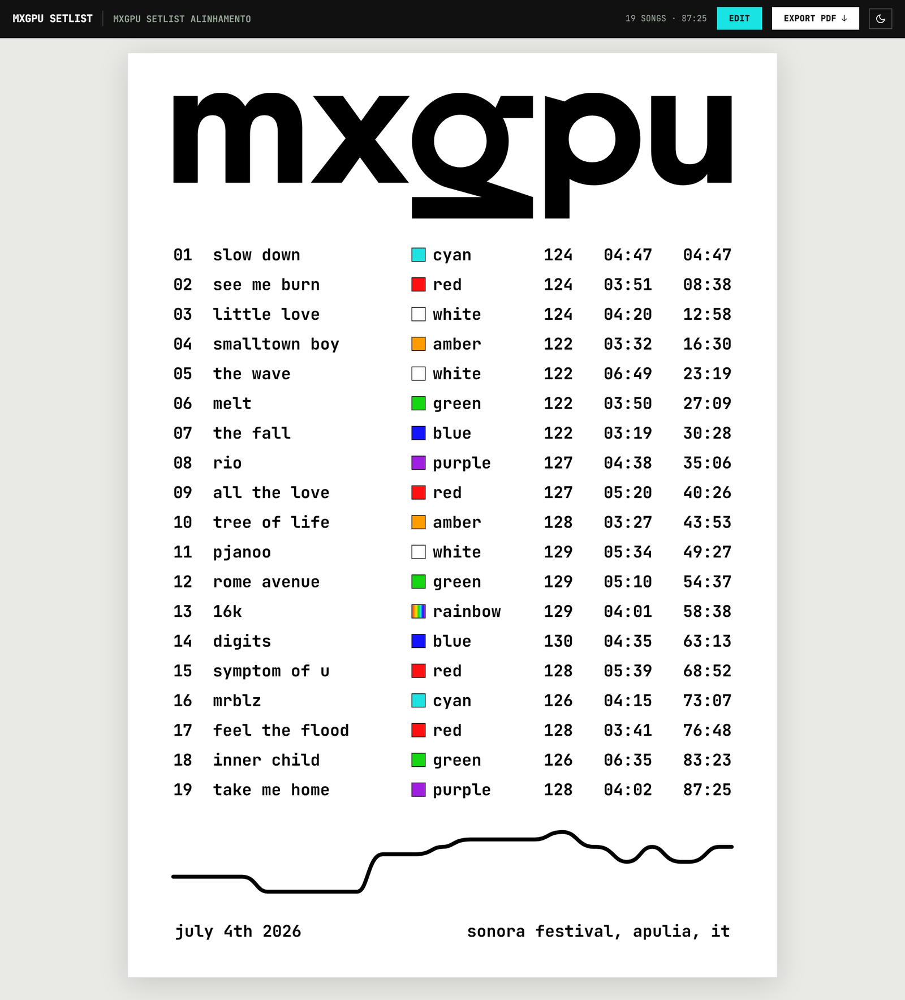
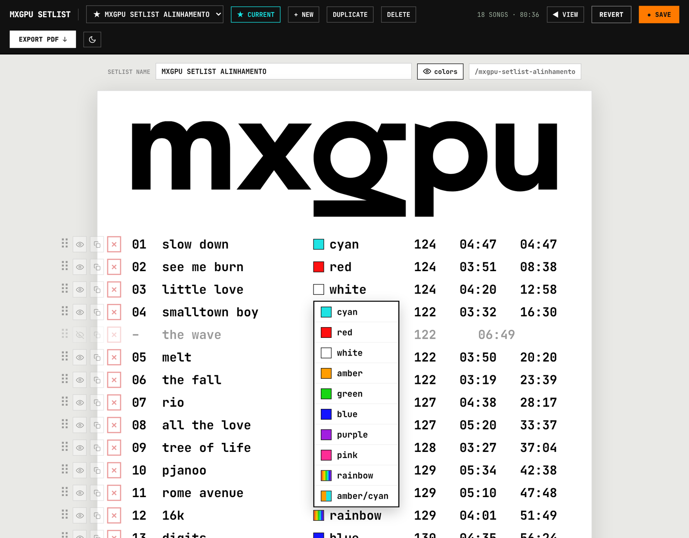

# setlist

A small web app for building, sharing and printing gig setlists.

Built for and used by [MXGPU](https://www.mxgpu.net), the immersive 360° live show by
Moullinex and GPU Panic, to build, share and print the set for every show.

- **Public view** (`/`) — anyone can see the current setlist, read-only, and **Export PDF**.
- **Per-setlist links** (`/<slug>`) — every setlist gets a human-readable URL.
- **Edit** — behind a password. Click **EDIT**, enter the password, and the builder unlocks:
  add/remove/reorder/hide/duplicate tracks, colours, BPM, durations, multiple named
  setlists, a BPM "energy" curve, date/venue. Changes are saved to the database.
- **Export PDF** — rendered server-side with headless Chromium to a clean single A4 page.
- Screen-only dark mode.

| Public view | Editor |
| --- | --- |
|  |  |

<sub>Screenshots from [MXGPU](https://www.mxgpu.net/blog/setlist-mxgpu-net)'s deployment, with their logo set in `site.config.ts`.</sub>

## Customising

Everything brand-related lives in **`site.config.ts`**:

| option | what it does |
| --- | --- |
| `name`, `description` | toolbar title, browser tab, web manifest |
| `logo` | artwork at the top of the sheet: `{ src: '/logo.svg', alt: '…', invertInDark: true }`. Drop the file into `public/`. `null` prints `name` as a text heading. |
| `fonts.stylesheet` | a CSS file declaring your typefaces — a Google Fonts URL, or a local `/fonts/fonts.css` with `@font-face` rules (put the font files in `public/fonts/`). Used by both the page and the PDF. |
| `fonts.ui` / `fonts.sheet` / `fonts.numbers` | CSS `font-family` for the toolbar, the sheet text, and the numeric columns |
| `features` | turn sheet fields on/off site-wide: `numbers`, `colors`, `bpm`, `duration`, `total` (running time), `curve`, `footer` (date + venue) |
| `id` | prefix for the edit cookie and local-storage keys |
| `table` | Postgres table name |

Fields left enabled in `features` can also be shown/hidden **per setlist** from the
editor's **SHOW** row; the PDF follows the same settings.

Example: a local typeface and a logo, no colour column anywhere:

```ts
logo: { src: '/logo.svg', alt: 'my band', invertInDark: true },
fonts: {
  stylesheet: '/fonts/fonts.css',
  ui: "'My Grotesk', sans-serif",
  sheet: "'My Grotesk', sans-serif",
  numbers: "'JetBrains Mono', monospace",
},
features: { numbers: true, colors: false, bpm: true, duration: true, total: true, curve: true, footer: true },
```

The colour palette (names, hex values, gradients) is in `lib/setlist.ts` (`COLORS`,
`COLOR_LIST`, `GRADIENT_STOPS`) and `lib/types.ts` (`ColorName`). The seed setlist shown
before anything is saved is `defaultDoc()` in `lib/setlist.ts`.

## Stack
- **Next.js** (App Router), deployable to **Vercel**
- **Neon Postgres** (`@neondatabase/serverless`) — the whole document is one JSONB row
- **Puppeteer + @sparticuz/chromium** for PDF export
- Server-side password gate: the password lives only in an env var; `/api/auth` verifies it
  and sets a signed, httpOnly cookie; `/api/setlist` (PUT) requires that cookie. The password
  is never shipped to the browser.

## Environment variables
See `.env.example`:

| var | purpose |
| --- | --- |
| `EDIT_PASSWORD` | password that unlocks editing |
| `AUTH_SECRET` | random string used to sign the edit-session cookie |
| `DATABASE_URL` | Neon Postgres connection string |

Without `DATABASE_URL` the app still renders the seed setlist read-only.

## Local development
```bash
npm install
cp .env.example .env.local   # then fill in the values
npm run dev                  # http://localhost:3000
```
Local PDF export uses your installed Google Chrome (set `CHROME_PATH` if it isn't in the
default macOS location).

## Project layout
```
site.config.ts     branding, fonts, feature switches
app/               Next.js routes
  page.tsx         "/" — the current setlist
  [slug]/          "/<slug>" — a specific setlist
  api/setlist/     GET (public read) + PUT (auth-gated write)
  api/auth/        POST password -> cookie, GET status, DELETE logout
  api/pdf/         server-rendered single-page PDF
components/
  SetlistApp.tsx   the read-only view + password-gated editor
lib/
  setlist.ts       pure helpers (curve, formatting, colours, visibility, seed data)
  render.ts        standalone HTML of the sheet for the PDF renderer
  db.ts            Neon access (single JSONB document)
  auth.ts          password check + cookie token
```

## License
MIT — see [LICENSE](LICENSE).
